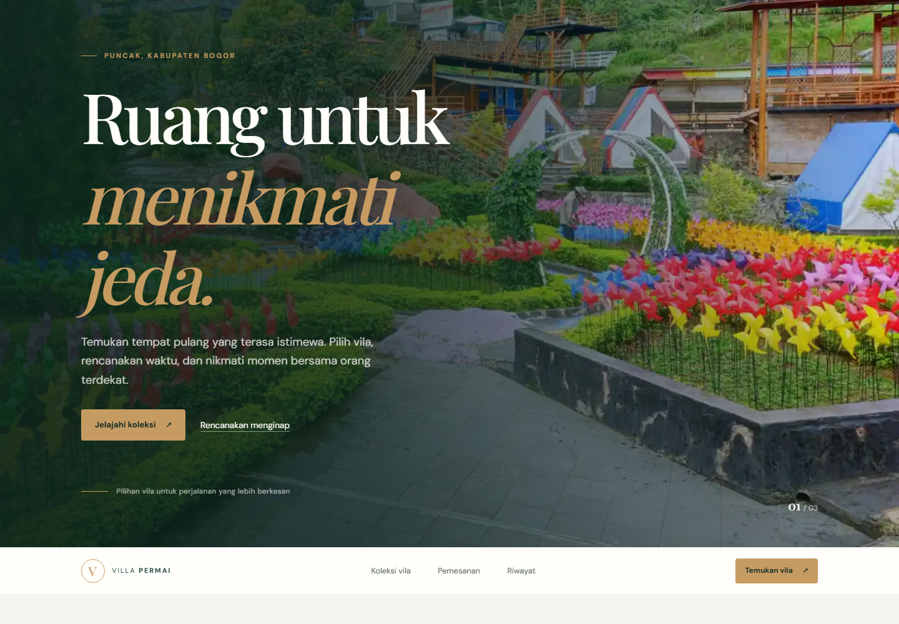
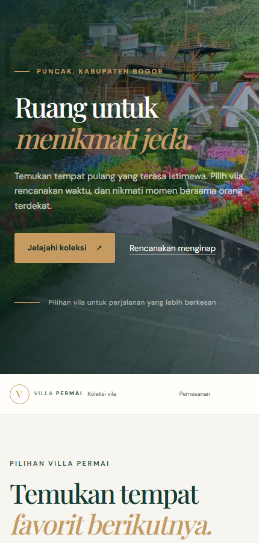

# Aplikasi Pemesanan Vila Permai

Project UTS Teknologi Web berupa website katalog dan simulasi pemesanan vila dengan tampilan resort premium yang responsif. Villa Permai dikelola dari kawasan Puncak, Bogor. Pengunjung dapat melihat pilihan vila di beberapa lokasi, mencari berdasarkan nama atau fasilitas, mengisi form, lalu melihat perkiraan harga dan menyimpan simulasi pesanannya di browser.

## Identitas

- **Nama:** Ade Evan Alvianysah
- **NIM:** 24011130331
- **Repository:** [Adeevanvansyah_24011130331_UTS_VillaPermai](https://github.com/adeevan2024-m-design/Adeevanvansyah_24011130331_UTS_VillaPermai)

## Sekilas tentang aplikasi

Halaman menampilkan Vila Khayangan, Villa Lembah Koi, dan Villa So Long Banyuwangi lengkap dengan foto, lokasi, jumlah kamar, fasilitas, harga per malam, dan status. Villa So Long Banyuwangi tetap ditampilkan dengan nama dan lokasi vilanya; identitas pemilik dan layanan Villa Permai berada di Puncak, Bogor. Pengunjung dapat mencari vila, menyaring ketersediaan, mengurutkan harga, dan menyimpan pilihan favorit.

Harga dihitung dari jumlah malam. Untuk setiap tamu di atas dua orang, ada tambahan Rp100.000 per malam. Estimasi diperbarui saat tanggal dan jumlah tamu diisi. Sebelum simulasi permintaan disimpan, aplikasi memeriksa isian form, tanggal, jumlah tamu, dan status vila.

### Yang bisa dicoba

- Cari kata seperti `Khayangan`, `Banyuwangi`, atau `WiFi`.
- Coba pilih Villa So Long Banyuwangi untuk melihat pesan bahwa vila sedang penuh.
- Isi form dengan tanggal check-in dan check-out, lalu lihat estimasi biaya langsung atau pilih **Cek ketersediaan** untuk memeriksa tanggal.
- Pilih **Kirim permintaan** untuk menyimpan simulasi pesanan ke riwayat perangkat.
- Gunakan filter ketersediaan dan urutan harga untuk membandingkan pilihan.
- Tekan ikon hati pada kartu vila untuk menyimpan favorit. Favorit disimpan pada perangkat.
- Pilih **Pilih vila** pada kartu yang tersedia untuk mengisi vila di formulir pemesanan.

## Pembaruan tampilan dan konten

- Memperbarui daftar vila menjadi Vila Khayangan, Villa Lembah Koi, dan Villa So Long Banyuwangi.
- Menambahkan foto setiap vila ke folder `assets/` dan menampilkannya pada kartu vila.
- Memperbarui tampilan dengan hero fotografi, tema resort premium, kartu vila, aksen emas, dan tata letak responsif untuk ponsel maupun desktop.
- Memperjelas identitas situs sebagai Villa Permai yang dikelola dari Puncak, Kabupaten Bogor.
- Menambahkan filter ketersediaan, pengurutan harga, daftar favorit tersimpan, dan tombol pemilihan vila dari kartu.
- Menampilkan rincian estimasi biaya saat tanggal dan jumlah tamu diisi, serta tautan WhatsApp dan email pemilik.

## Menjalankan project

Project tidak memerlukan instalasi package atau server backend.

1. Clone repository atau unduh sebagai ZIP dari GitHub.
2. Buka folder project di VS Code.
3. Buka `index.html` langsung di browser. Jika menggunakan ekstensi Live Server, klik kanan `index.html`, lalu pilih **Open with Live Server**.

Untuk clone melalui terminal:

```bash
git clone https://github.com/adeevan2024-m-design/Adeevanvansyah_24011130331_UTS_VillaPermai.git
cd Adeevanvansyah_24011130331_UTS_VillaPermai
```

## Isi repository

```text
├── index.html                    # Struktur halaman
├── style.css                     # Tampilan dan aturan responsif
├── script.js                     # Data vila dan proses pemesanan
├── README.md                     # Dokumentasi project
└── assets/
    ├── vila-khayangan.webp
    ├── villa-lembah-koi.jpg
    ├── villa-so-long-banyuwangi.webp
    ├── villa-permai-desktop-preview.png
    ├── villa-permai-mobile-preview.png
    ├── villa-permai-desktop-full.png
    └── villa-permai-mobile-full.png
```

## Tampilan

Pratinjau berikut menampilkan desain terbaru pada layar desktop dan ponsel.

### Pratinjau Desktop



### Pratinjau Mobile



Tangkapan layar halaman penuh, dari bagian atas sampai footer:

### Desktop


### Mobile


## Catatan penggunaan

Ini adalah demo front-end, bukan sistem reservasi yang terhubung ke pemilik vila. Form hanya menyimpan simulasi permintaan dan tidak memproses pembayaran atau mengonfirmasi reservasi. Data vila dan status ketersediaannya ditentukan di `script.js`. Nama terakhir, riwayat simulasi, dan daftar favorit disimpan menggunakan `localStorage`, jadi hanya tersedia pada browser dan perangkat yang digunakan. Menghapus data browser juga akan menghapus data tersebut.

## Riwayat commit

Riwayat lengkap dapat dilihat di [halaman commits repository](https://github.com/adeevan2024-m-design/Adeevanvansyah_24011130331_UTS_VillaPermai/commits/main/), atau dari folder project dengan perintah `git log --oneline`.

Beberapa commit yang menandai perkembangan project:

| Commit | Keterangan |
| --- | --- |
| `0e107be` | Menambahkan file awal aplikasi |
| `5433539` | Merapikan README dan menambahkan `.gitignore` |
| `1624460` | Menambahkan panduan penggunaan dan preview |
| `0385a06` | Menambahkan screenshot mobile |
| `3183a04` | Menyesuaikan README dengan identitas dan format tugas |
| `dfe8009` | Menambahkan screenshot penuh desktop dan mobile |

## Teknologi

HTML, CSS, dan JavaScript. Data nama tamu terakhir, riwayat simulasi, dan daftar favorit disimpan di `localStorage` browser.
