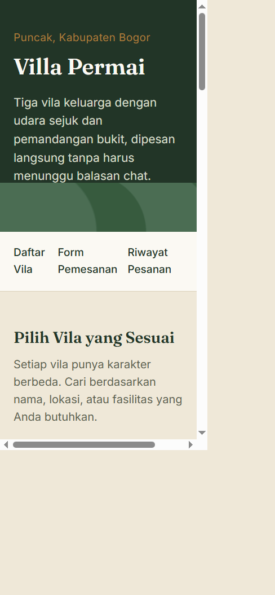

# Villa Permai — Aplikasi Pemesanan Vila Berbasis Web

Aplikasi web statis untuk pemesanan vila Villa Permai di kawasan Puncak, Kabupaten Bogor. Project ini dibuat untuk membantu calon tamu melihat daftar vila, mengecek ketersediaan, menghitung perkiraan biaya, dan mengirim pesanan tanpa harus berkomunikasi lewat WhatsApp secara manual.

## Repository GitHub

- GitHub: https://github.com/adeevan2024-m-design/Adeevanvansyah_24011130331_UTS_VillaPermai

## Deskripsi Proyek

Project ini menampilkan tiga unit vila dengan informasi seperti nama, tipe, lokasi, harga, fasilitas, dan status ketersediaan. Semua data disimpan dalam array objek di file `script.js` dan ditampilkan secara dinamis ke halaman menggunakan JavaScript.

## Struktur Folder

```text
uts-vila-permai/
├── index.html
├── style.css
├── script.js
├── README.md
├── .gitignore
└── assets/
    └── villa-permai-mobile.png
```

## Fitur

- Menampilkan daftar 3 vila dengan status tersedia / penuh
- Pencarian vila berdasarkan nama, lokasi, atau fasilitas
- Form pemesanan dengan validasi input
- Hitung total biaya otomatis berdasarkan lama menginap dan jumlah tamu
- Penyimpanan data terakhir dan riwayat pesanan ke `localStorage`
- Tampilan responsif untuk desktop, tablet, dan ponsel

## Tampilan Aplikasi

### Tampilan di Web/Desktop

- Header hero dengan judul besar dan tagline Villa Permai
- Navigasi cepat ke bagian daftar vila, form pemesanan, dan riwayat pesanan
- Kartu vila ditampilkan dalam layout yang rapi dan dua kolom pada layar lebar
- Form pemesanan berada di bagian terpisah dengan kolom input yang jelas
- Hasil perhitungan biaya tampil langsung setelah tombol "Cek Ketersediaan" diklik

### Tampilan di Mobile

Berikut hasil tampilan pada viewport ponsel berukuran 390 × 844 piksel. Kartu vila tersusun vertikal dan navigasi menyesuaikan lebar layar.



- Layout beradaptasi menjadi satu kolom agar mudah dibaca di layar kecil
- Input form dan tombol menyesuaikan lebar layar perangkat
- Pencarian, pemesanan, dan riwayat pesanan tetap dapat diakses dengan nyaman

## Cara Menjalankan

1. Pastikan Anda sudah berada di folder project.
2. Buka file `index.html` di browser.
3. Atau jalankan Live Server di VS Code agar file CSS dan JavaScript terbaca dengan benar.

Contoh browser langsung:

```text
file:///C:/path/ke/folder/project/index.html
```

## Cara Pakai Aplikasi

1. Buka halaman utama `index.html`.
2. Cari vila yang ingin dipesan menggunakan kolom pencarian.
3. Pilih vila pada form pemesanan.
4. Isi data tamu seperti nama, tanggal check-in, tanggal check-out, dan jumlah tamu.
5. Klik tombol `Cek Ketersediaan` untuk melihat estimasi biaya.
6. Klik tombol `Pesan Sekarang` untuk menyimpan pesanan dan menampilkan riwayat pemesanan.
7. Riwayat pesanan akan tersimpan di browser melalui `localStorage` dan tetap muncul saat halaman dibuka kembali.

## Validasi Form

Form ini sudah dilengkapi dengan validasi berikut:

- Nama tamu wajib diisi
- Vila harus dipilih
- Tanggal check-in dan check-out wajib diisi
- Tanggal check-out harus lebih besar dari check-in
- Tanggal check-in tidak boleh di masa lalu
- Jumlah tamu harus 1–10 orang

## Logika Harga

Perhitungan total biaya menggunakan rumus berikut:

```text
total = harga per malam × jumlah malam
```

Jika jumlah tamu lebih dari 2 orang, maka biaya tambahan Rp100.000 per malam akan dikenakan untuk setiap tamu tambahan.

## Riwayat Commit

Riwayat lengkap beserta hash commit dapat dilihat di [halaman commits GitHub](https://github.com/adeevan2024-m-design/Adeevanvansyah_24011130331_UTS_VillaPermai/commits/main/). Untuk melihatnya dari terminal:

```bash
git log --oneline
```

Beberapa tahap pengembangan utama:

- `Initial commit` — menambahkan file awal aplikasi
- `docs: refresh README and add gitignore` — memperbarui dokumentasi project
- `docs: add app preview and usage guide` — menambahkan panduan penggunaan dan preview

## Riwayat Pengembangan

Project ini dibuat secara bertahap dalam beberapa tahap:

1. Pembuatan struktur halaman utama
2. Styling dasar dan responsif layout
3. Render data vila dan form pemesanan dengan JavaScript
4. Penambahan validasi, localStorage, dan hitung total biaya
5. Perbaruan dokumentasi README dan penambahan `.gitignore`

## Informasi Pemilik

- Nama usaha: Villa Permai
- Lokasi: Puncak, Kabupaten Bogor
- Kontak pemilik: Pak Hendra
- WhatsApp: 0812-9045-2217

## Status Project

Project ini siap digunakan sebagai tugas UTS dan sudah berfungsi sebagai aplikasi pemesanan vila berbasis web statis.
