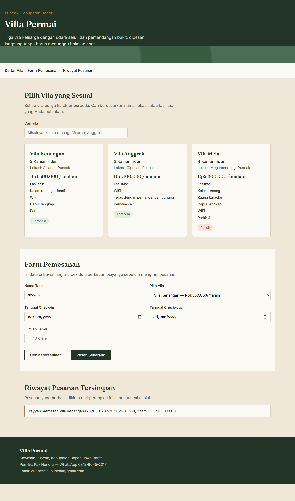
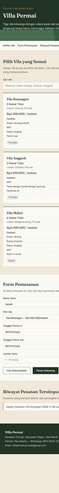

# UTS Teknologi Web - Aplikasi Pemesanan Vila Permai

## Identitas Mahasiswa

- **Nama:** Ade Evan Alvianysah
- **NIM:** 24011130331
- **Nama Repository:** `Adeevanvansyah_24011130331_UTS_VillaPermai`
- **GitHub:** [adeevan2024-m-design/Adeevanvansyah_24011130331_UTS_VillaPermai](https://github.com/adeevan2024-m-design/Adeevanvansyah_24011130331_UTS_VillaPermai)

## Deskripsi Aplikasi

Villa Permai adalah aplikasi web statis untuk melihat informasi vila di kawasan Puncak, Bogor, dan mengisi simulasi pemesanan. Aplikasi dibuat menggunakan HTML, CSS, dan JavaScript tanpa server atau database. Data vila disimpan di dalam JavaScript, sedangkan nama tamu terakhir dan riwayat pesanan disimpan di `localStorage` browser.

## Cara Menjalankan

### Menggunakan Git

```bash
git clone https://github.com/adeevan2024-m-design/Adeevanvansyah_24011130331_UTS_VillaPermai.git
cd Adeevanvansyah_24011130331_UTS_VillaPermai
```

Buka `index.html` di browser, atau buka folder project di VS Code dan pilih **Open with Live Server**.

### Tanpa Git

Unduh project melalui tombol **Code > Download ZIP** di repository GitHub, ekstrak file ZIP, lalu buka `index.html` di browser.

## Struktur Project

```text
Adeevanvansyah_24011130331_UTS_VillaPermai/
├── index.html
├── style.css
├── script.js
├── README.md
└── assets/
    ├── villa-permai-desktop-full.png
    └── villa-permai-mobile-full.png
```

## Status Fitur

- [x] Menampilkan tiga vila beserta tipe, lokasi, fasilitas, harga, dan status
- [x] Mencari vila berdasarkan nama, lokasi, atau fasilitas
- [x] Menghitung perkiraan biaya berdasarkan jumlah malam
- [x] Menambahkan biaya Rp100.000 per tamu per malam untuk tamu di atas dua orang
- [x] Memvalidasi nama, vila, tanggal, dan jumlah tamu (1–10 orang)
- [x] Menyimpan nama tamu terakhir dan riwayat pesanan di `localStorage`
- [x] Menyesuaikan tampilan untuk desktop dan layar mobile

> **Catatan:** Ini merupakan simulasi front-end. Data pemesanan hanya tersimpan di browser yang digunakan dan tidak dikirim ke server atau pemilik vila. Status ketersediaan merupakan data contoh di dalam aplikasi.

## Tangkapan Layar

Screenshot di bawah merupakan tangkapan satu halaman penuh, bukan potongan terpisah. Gambar mencakup halaman aplikasi dari header hingga footer.

### Tampilan Desktop



### Tampilan Mobile



## Cara Menggunakan Aplikasi

1. Buka aplikasi melalui `index.html`.
2. Cari vila menggunakan kolom **Cari vila**.
3. Pada **Form Pemesanan**, pilih vila dan masukkan nama, tanggal check-in, tanggal check-out, serta jumlah tamu.
4. Pilih **Cek Ketersediaan** untuk melihat ringkasan estimasi biaya.
5. Pilih **Pesan Sekarang** untuk menyimpan simulasi pesanan dan melihatnya di bagian **Riwayat Pesanan Tersimpan**.

Riwayat dapat dilihat kembali selama data browser tidak dihapus dan aplikasi dibuka di browser/perangkat yang sama.

## Riwayat Commit

Riwayat lengkap dan terbaru tersedia di [GitHub Commits](https://github.com/adeevan2024-m-design/Adeevanvansyah_24011130331_UTS_VillaPermai/commits/main/). Untuk melihatnya dari terminal:

```bash
git log --oneline
```

Riwayat commit utama:

```text
3183a04 docs: format README with student info and screenshots
0385a06 docs: add mobile screenshot to README
1624460 docs: add app preview and usage guide
5433539 docs: refresh README and add gitignore
0e107be Initial commit
```

## Teknologi

- HTML5
- CSS3
- JavaScript
- `localStorage`
